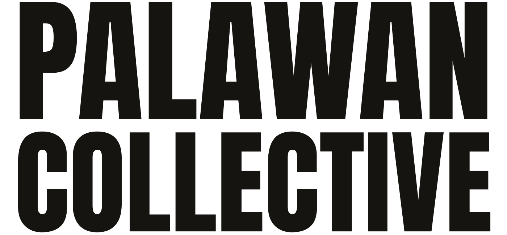

  <picture>
    <source media="(prefers-color-scheme: dark)" srcset="public/images/palawan-collective-wordmark-light.svg">
    
  </picture>

# Palawan Collective + MerQato Digital

**DESIGN ?? DEVELOPMENT ?? AUTOMATION**

**Local businesses. Distinct digital worlds.**

We are an independent creative technology studio rooted in Palawan, Philippines, building thoughtful websites, digital systems, and practical automation for ambitious businesses.

We combine design, development, and technology to create digital experiences that reflect each business and help it work better. From responsive websites and customer-facing platforms to business management systems, AI agents, and automated workflows, we build useful digital tools designed around real operational needs.

## What We Do

**01 ??? Websites & Digital Experiences**  
Distinctive, responsive websites and landing pages designed around each business, its customers, and its goals.

**02 ??? Digital Systems & Applications**  
Practical web applications, dashboards, CRM systems, booking platforms, ordering systems, and business management tools.

**03 ??? Automation & AI**  
AI agents, intelligent workflows, integrations, and automation that reduce repetitive work while keeping people in control.

**04 ??? Digital Strategy & Ongoing Support**  
From initial strategy and development to deployment, hosting, maintenance, and continuous improvement.

## Our Approach

Good digital work should feel like it belongs to you.

Every business has its own rhythm. We start by understanding how it works, then build digital experiences and systems that are clear, useful, and unmistakably its own.

We believe in practical technology, thoughtful design, long-term relationships, and giving businesses digital tools they can build on.

## The Studio

**MerQato Digital** is our creative technology and digital systems studio. **Palawan Collective** is our broader platform for regional creativity, marketing, content, and destination-focused initiatives.

Rooted in Palawan. Working everywhere.

## Technology & Infrastructure

Our work spans modern web development, Git-based workflows, cloud deployments, databases, APIs, AI model integrations, and self-hosted open-source tools.

We use tools such as GitHub, Vercel, Coolify, Cloudflare, and PostgreSQL-based services where appropriate to each project.

## Contact

**Email:** david@palawancollective.com  
**Website:** https://merqato.digital/  
**Focus:** Design ?? Development ?? Automation  
**Location:** Palawan, Philippines
